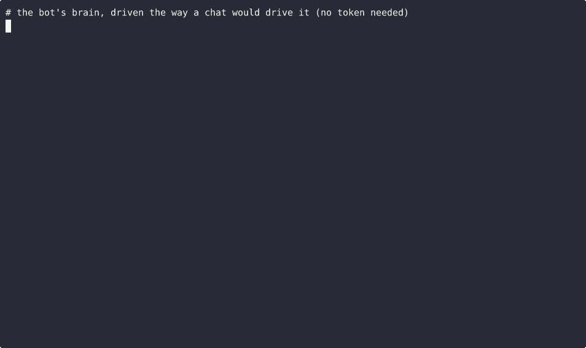

# remindbot



A reminder bot for Telegram and Discord.

```
/remind in 10m stretch
/remind at 5pm call Sam
/remind tomorrow 9am gym
/remind 2026-12-01 rent
/list
/cancel 3
/tz America/New_York
```

## The parts most reminder bots get wrong

Restarts. Reminders live in SQLite, not in memory, so a restart or a crash loses nothing. If one came due while the bot was offline it still gets sent, once, with a note saying how late it is.

Sending twice. Each reminder is claimed before it's sent, so two overlapping checks can't both send it.

Bad connections. If Telegram or Discord has a network problem the reminder goes back in the queue and tries again. If the bot was blocked or the chat is gone, it's dropped and logged instead of retrying forever.

Daylight saving. Times are read in the chat's own timezone. "tomorrow 9am" set the day before the clocks change still fires at 9am on the wall.

"2 hours" means two hours from now, not 2 o'clock.

Cancelling only works inside your own chat, so nobody can cancel someone else's reminder by guessing a number.

## Layout

`remindbot/` holds all the logic (parsing, storage, what's due). It knows nothing about any chat app.

`adapters/telegram_bot.py` and `adapters/discord_bot.py` only move text in and out, about 50 lines each.

## Run

```
pip install -e .
TELEGRAM_TOKEN=... python -m adapters.telegram_bot
DISCORD_TOKEN=... python -m adapters.discord_bot
```

Discord needs the Message Content intent switched on for the bot.

## Tests

`./check.sh` runs 31 tests. They cover the parser, the daylight saving dates for New York in 2026 and 2027, a restart in the middle, the double send, the late note, and both adapters with fake network failures. Nothing in the tests talks to Telegram or Discord.
